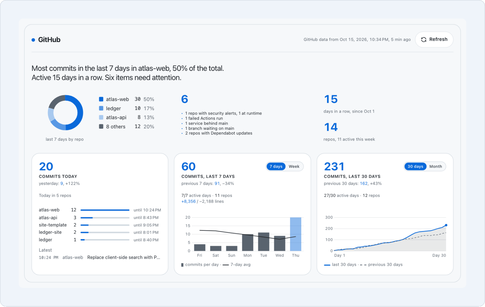
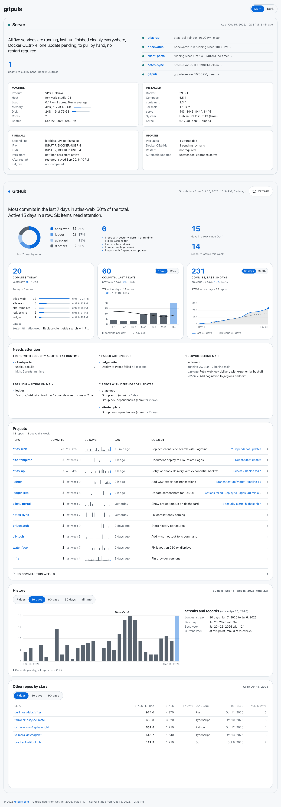
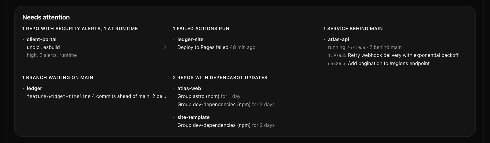
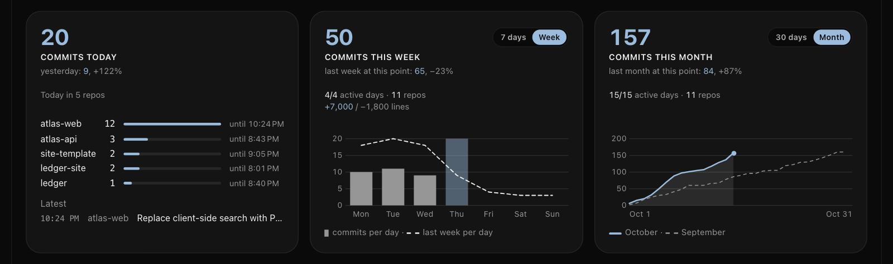
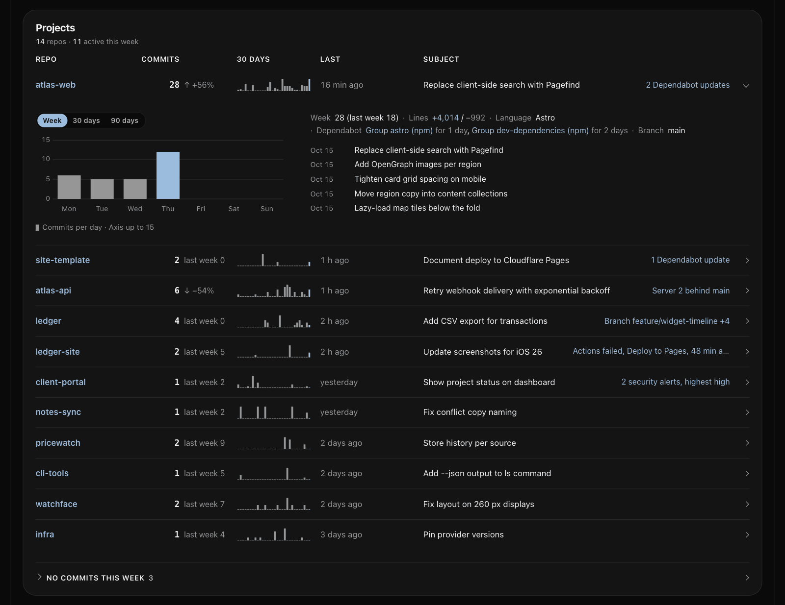
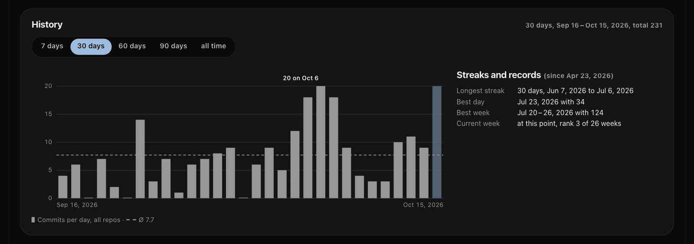
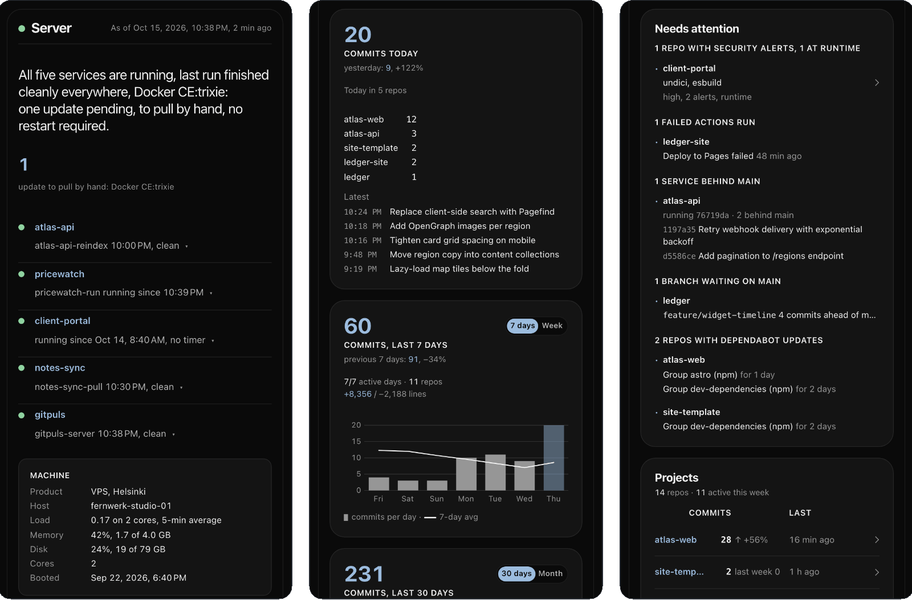
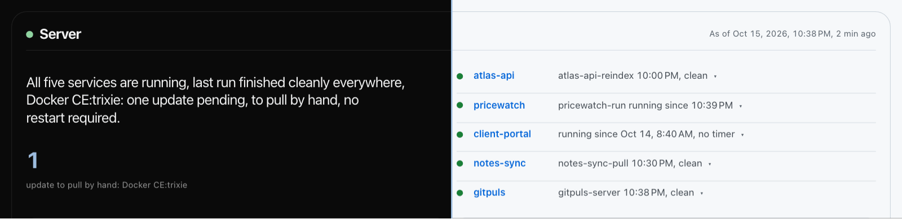

<div align="center">

<picture>
  <source media="(prefers-color-scheme: dark)" srcset="docs/wordmark-dark.svg">
  
</picture>

<p>A self-hosted dashboard that shows what you worked on across your own GitHub repositories, what needs attention, and optionally the state of the server it runs on.</p>

<p><a href="https://gitpuls.com"><b>Website</b></a> · <a href="#quick-start">Quick start</a> · <a href="#limits-of-v1">Limits of v1</a></p>

<p>
<a href="LICENSE"></a>
<a href="https://github.com/cidix/gitpuls/pkgs/container/gitpuls"></a>


</p>

<p><sub>Published as is, no support. <a href="#status">Status</a></sub></p>

<picture>
  <source media="(prefers-color-scheme: dark)" srcset="docs/screenshots/hero-dark.png">
  
</picture>

</div>

## The whole page

<picture>
  <source media="(prefers-color-scheme: dark)" srcset="docs/screenshots/full-page-dark.png">
  
</picture>

*All images come from the bundled demo data (`demo/demodaten.py`); all names are invented.*

## What you see

### Server

The server zone sums up the host in one sentence and lists your services with their last timer run; each row opens to its containers, runs and distance to the default branch.

Load, memory, disk and boot time of the machine next to the versions of Docker, Compose, containerd, Tailscale, the system and the kernel.

Rules in INPUT and DOCKER-USER per IP family, whether they survive a reboot, and pending apt updates, including the ones you have to pull by hand.

<picture>
  <source media="(prefers-color-scheme: dark)" srcset="docs/screenshots/server-zone-dark.png">
  
</picture>

### Needs attention

Everything that needs you in one block: security alerts, failed Actions runs, services behind the default branch, waiting branches, Dependabot updates and values that could not be measured.



### Today, 7 days and 30 days

Today against all of yesterday; the last 7 days or this week and the last 30 days or this month against the period before, up to the same point in time.



### Projects

One row per repository with its commits, a 30-day sparkline and its findings; a row opens to the week, the lines changed and the latest subjects.



### History

Commits per day over 7, 30, 60 or 90 days or since the start, with streaks and records.



### On a phone

The same page on a narrow screen.



### Light and dark

Follows the system setting, or pick one yourself.



## Quick start

Requirements: Docker Engine 28 or later with Docker Compose, and a fine-grained GitHub token (see below).

```sh
git clone https://github.com/cidix/gitpuls.git && cd gitpuls
cp compose.example.yaml compose.yaml
cp .env.example .env                     # set TZ and GITPULS_ADRESSEN at least
cp deploy/github.env.beispiel github.env # put your token after GITHUB_TOKEN=
chmod 0644 github.env                    # the container reads it as UID 10001; or chgrp 10001 and 0640
docker compose up -d
```

Open http://127.0.0.1:8789. The first collector run starts with the container and fetches the full history of your repositories; depending on their size this takes a few minutes. `docker compose up` pulls the published image and builds from source if the tag is not published.

### GitHub token

Create a [fine-grained personal access token](https://github.com/settings/personal-access-tokens/new) with an expiry date, resource owner your account, repository access "All repositories", and these permissions, each **read-only**:

| Permission | Used for |
|---|---|
| Contents | commits, branches, comparison with the default branch |
| Metadata | list of repositories (always included) |
| Actions | result of the last workflow run on the default branch |
| Dependabot alerts | open security alerts |

Without Actions or Dependabot alerts the dashboard shows "not measured" for those values. gitpuls warns 14 days before the token expires. The token lives in a file mounted read-only into the container, never in an environment variable.

## Configuration

<details>
<summary>All settings go into <code>.env</code> next to <code>compose.yaml</code> (template: <code>.env.example</code>); the host scripts in <code>deploy/</code> read the same file.</summary>

| Variable | Default | Meaning |
|---|---|---|
| `TZ` | required | Your time zone (IANA name). Days, weeks and months are counted in it. |
| `GITPULS_ADRESSEN` | required | Commit email addresses that count as yours, comma separated. Add your `ID+login@users.noreply.github.com` address. |
| `GITPULS_SPRACHE` | `en` | Interface language, `en` or `de`; `?lang=` overrides it per request. |
| `GITPULS_FORMAT` | empty | Locale for numbers and dates, e.g. `en-GB`; empty follows the browser's Accept-Language. |
| `GITPULS_PORT` | `8789` | Port on `127.0.0.1`. |
| `GITPULS_HOSTS` | empty | Allowed host names in the Host header, comma separated (e.g. your reverse proxy name). Loopback is always allowed; any other host gets 421. |
| `GITPULS_TOKENDATEI` | `./github.env` | File with `GITHUB_TOKEN=...`. |
| `GITPULS_VOLUME` | `gitpuls-daten` | Docker volume for the database. |
| `GITPULS_TAKT_MIN` | `60` | Collector interval inside the container in minutes. `0` disables it; a negative, infinite or non-numeric value stops the start with an error. |
| `GITPULS_TAG` | `2.1.0` | Image tag. The footer shows the version built into the image; an image built from source shows this tag instead. |
| `GITPULS_DIENSTE` | `tools/dienste.json` | Service table for the server zone (example: `tools/dienste.beispiel.json`). Service names must be unique; an invalid entry is shown as "not measured" and affects only itself. |
| `GITPULS_PRODUKT` | empty | Product line of the machine shown in the server zone. |
| `GITPULS_SERVER_ZIEL`, `GITPULS_DEPLOY_ZIEL` | in the volume | Where the host scripts write `server.json` and `deploy.json`. |
| `GITPULS_BIND` | `0.0.0.0` | Bind address inside the container (the port is published on `127.0.0.1` only). |

To use an existing volume that `docker compose down -v` must not remove, create `compose.override.yaml` next to `compose.yaml` with `volumes: {daten: {external: true}}`; Docker Compose and podman-compose both read it.

</details>

### Optional: server zone

<details>
<summary>Two host scripts measure the server and write files the dashboard reads; without them the dashboard shows only the GitHub part.</summary>

`tools/server-stand` (Python 3, run as root on the host) and `tools/deploy-stand.sh` write `server.json` and `deploy.json` into the data volume; the web process only reads these files and has no Docker socket. Templates for systemd units and timers are in `deploy/` (the paths there are examples). Without these files the dashboard shows only the GitHub part. Every value the host script cannot measure (missing tool, denied access) is shown as "not measured".

</details>

## Limits of v1

- Only the default branch of each repository is counted; work on other branches shows up as "waiting on main" until it is merged.
- A commit is counted once, in the repository where it was first seen.
- The server zone covers firewall rules from iptables and pending updates from apt only (Debian, Ubuntu). Whether the rules survive a reboot is measured for iptables-persistent only; with ufw or nftables.service it shows "not measured". On a host with nftables and without iptables the rules themselves are "not measured".
- `tools/server-stand` reads containers through the `docker` CLI. With rootless Docker, set `DOCKER_HOST` (e.g. `unix:///run/user/1000/docker.sock`) and `GITPULS_SERVER_ZIEL` (the volume's mount point from `docker volume inspect gitpuls-daten`, plus `/server.json`) in `.env`. With Podman, set `GITPULS_SERVER_ZIEL` the same way and install `podman-docker`; without it, containers show "not measured".

## Status

**Status: published as is, no support.** Shared publicly in case it is useful to others and provided "as is", without warranty of any kind (see LICENSE); no support, no maintenance guarantee, no roadmap. Bug reports are welcome but not guaranteed a response; pull requests are not accepted. Security problems: please use private vulnerability reporting. Do not expose it to the internet without an authenticating reverse proxy. You are responsible for running and updating your own instance.

## Security

<details>
<summary>gitpuls has no login of its own and is published on <code>127.0.0.1</code> only; read this before you make it reachable from anywhere else.</summary>

- The port is published on `127.0.0.1` only. Before you make gitpuls reachable from anywhere else, put a reverse proxy **with authentication** in front of it and add its host name to `GITPULS_HOSTS`. gitpuls has no login of its own; commit messages of private repositories, host names and package versions would otherwise be public.
- Requests with a host name that is not allowed are rejected with 421 (DNS rebinding). The refresh button (`POST /lauf`) only accepts requests from the page's own origin.
- Use Docker Engine 28 or later: before 28.0.0, hosts on the same layer-2 network could reach ports published on `127.0.0.1`.
- The container runs as UID 10001 with a read-only root file system and no capabilities.

</details>

## Upgrade and backup

<details>
<summary>Pull and restart; all data is one SQLite file that can be rebuilt from GitHub.</summary>

```sh
git pull
docker compose pull && docker compose up -d   # or: docker compose build && docker compose up -d
```

Read `CHANGELOG.md` before upgrading; breaking changes only come with a new major version. All data is one SQLite file in the volume (`/data/gitpuls.db`). It can be rebuilt from GitHub at any time (`docker compose run --rm gitpuls python -m app.sammler --alles`).

</details>

## Development

<details>
<summary>Tests, demo data and the images in this README.</summary>

Code comments and identifiers are in German. Tests: `python3 -m venv .venv && .venv/bin/pip install --require-hashes -r requirements.txt`, then `.venv/bin/python -m tests.<module>` for each module in `tests/`. Demo data and screenshots: `demo/demodaten.py` and `demo/aufnahmen.mjs`; the latter also writes the images of this README in full quality to `demo/aufnahmen/readme/`, from which `docs/screenshots/` holds palette-reduced PNGs.

</details>

## License

MIT, see [LICENSE](LICENSE).
